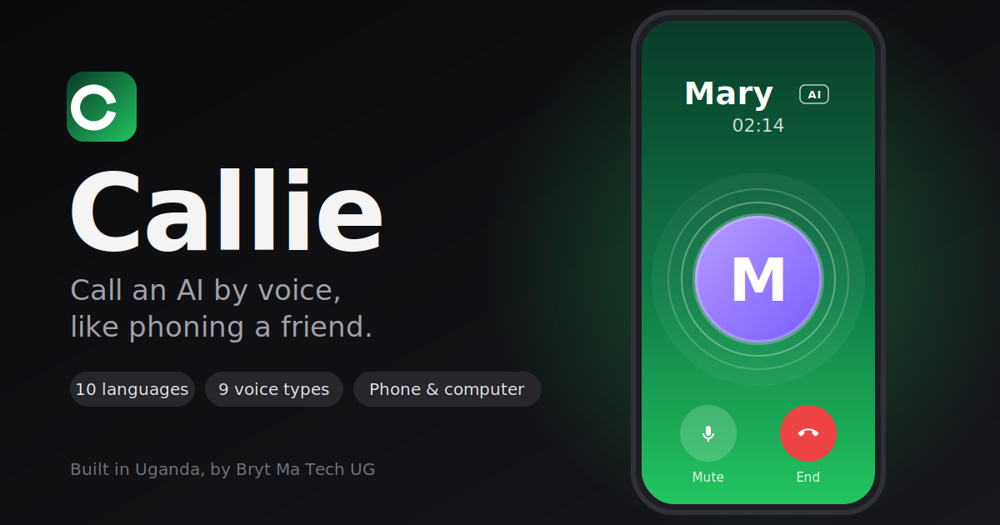

<p align="center"></p>

# Callie

**Call an AI by voice, like phoning a friend.** Pick a contact, hear it ring, and just talk. Each contact has its own name, voice and language, and every call is clear that you are talking to an AI.

> Built in Uganda, by **Bryt Ma Tech UG**.

[Landing page](https://muhumuza684.github.io/callie/) · [Guide](docs/GUIDE.md) · [Download](https://github.com/muhumuza684/callie/releases/latest)

## Download

| System | File |
|---|---|
| Windows | [`Callie-windows.exe`](https://github.com/muhumuza684/callie/releases/latest/download/Callie-windows.exe) |
| Mac (Apple silicon) | [`Callie-macos.tar.gz`](https://github.com/muhumuza684/callie/releases/latest/download/Callie-macos.tar.gz) |
| Linux | [`Callie-linux.tar.gz`](https://github.com/muhumuza684/callie/releases/latest/download/Callie-linux.tar.gz) |
| Android, iPhone | install from the browser - see [the guide](docs/GUIDE.md#use-it-on-your-phone) |

On Windows, if you see *"Windows protected your PC"*, choose **More info**, then **Run anyway**. Put the file on your Desktop and double-click it. The first run asks for a free access key; step-by-step help is in the [guide](docs/GUIDE.md#first-run).

## What it does

- **Phone-style calling** - ringing, a green call screen, mute and end, recents, and scheduled calls that ring like an incoming call.
- **Real conversation** - turn-taking, interruptions, it waits when you pause mid-sentence, and says "one moment" when the network is slow.
- **Contacts with personality** - choose a name, one of 9 voice types and one of 10 languages (English, Kiswahili, Luganda, Francais, Espanol, Deutsch, Arabic, Chinese, Hindi, Portuguese).
- **Optional memory** - off by default; when on, a contact remembers earlier calls so you can continue.
- **Your look** - six themes and five ringtones, or the phone's own sound.
- **Calm and professional** - people only see friendly wording, never technical errors; support is one tap away in Settings.
- **Everywhere** - Windows, Mac and Linux apps, and installable on Android and iPhone.
- **Safe by design** - it says it is an AI at the start of every call, keeps no recordings, and points to help if someone talks about harming themselves.

## How it works

```
 Window (app or phone)                          Callie (your computer)
 ---------------------                          -----------------------------------------------
 microphone -> audio frames --WebSocket-->       voice detection (turn-taking)
                                                 -> speech recognition (about 99 languages)
                                                 -> AI replies, with automatic fallback to other models
 speaker  <- voice or text  --WebSocket--        -> natural English voice, or the device's own voice
 contacts, schedule, settings  <-- REST --       small local store (contacts, memory)
```

## Languages

Callie listens in about 99 languages and answers in the language of each contact: English, Kiswahili, Francais, Espanol, Deutsch, Arabic, Chinese (Mandarin), Hindi and Portuguese. **Luganda** comes from [Sunbird AI](https://sunbird.ai), a Ugandan non-profit: listening, thinking and speaking. It is optional and appears only when a free Sunbird token is configured, and it is isolated, so if that service is slow or down the other languages are not affected. Setup is in the [guide](docs/GUIDE.md#luganda-optional).

## Run from source

Requirements: Python 3.10+ and a free access key.

```powershell
.\Callie.cmd                  # Windows: creates the environment, asks for the key, starts Callie
.\scripts\setup.ps1           # or step by step: install, run the tests
.\scripts\run.ps1
```

The launcher menu also pushes to GitHub, publishes a release and frees disk space. More in the [guide](docs/GUIDE.md#for-developers).

## Releases

Raise the number in `VERSION`, then choose **Publish a release** in the launcher (or run `.\scripts\release.ps1`). GitHub Actions runs the tests, builds the Windows, Mac and Linux apps and attaches them to a Release. The landing page lives in `docs/` and is published with GitHub Pages.

## Hosting

Callie can also run as an always-on service with invite-code sign-in, separate data for every person, fair-use limits and a delete-my-data button. It ships with a `Dockerfile`, a Docker Compose file with automatic https, and a Fly.io template. Step-by-step instructions, costs and a safety checklist are in [docs/HOSTING.md](docs/HOSTING.md).

## Project structure

```
Callie.cmd  VERSION  callie.spec     launcher, version number, packaging recipe
client/pwa/                          the app (index.html, app.js, style.css, setup.html, icons, manifest)
desktop/                             desktop app: starts Callie and opens its window
server/                              API, calls, speech/AI/failover, storage, memory, config
pipeline/  audio/  conversation/     one call: turn-taking, audio helpers, topic and mood profile
scripts/                             setup, run, phone link, push, release, clean-up, migration
tests/                               automated tests
docs/                                landing page and guide
.github/workflows/build.yml          builds and releases the apps
```

## Privacy

No recordings are saved. Speech is processed only to understand and answer. Memory is off unless switched on, and can be cleared in Settings. Your key, contacts and memory stay in a folder on your own computer and are never committed to git. See [Privacy in the guide](docs/GUIDE.md#privacy).

## Roadmap

1. Push notifications so scheduled calls ring when the phone screen is off.
2. First-run privacy and consent screen.
3. Text and transcript option for accessibility.
4. Email sign-in so one person can use their account on several devices (hosting with invite codes is built).
5. Offline fallback for listening and speaking.
6. Custom voices, recorded only with the speaker's explicit consent.
7. A native Android app for a true locked-screen incoming call.

## Support

Open **Settings > Support** in the app, or write to muhumuzabright26@gmail.com or brytma616@gmail.com.

## License

All rights reserved by Bryt Ma Tech UG until a license is chosen.
